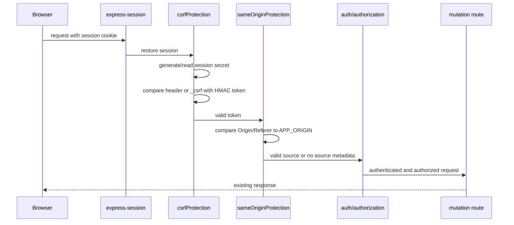

# C-01 CSRF Implementation Details

## Executive Summary

The application previously imported `sameOriginProtection` but left it unregistered. The middleware also returned `next()` when both `Origin` and `Referer` were absent, so it was not a complete CSRF control. Authenticated browser mutations could therefore be submitted with the victim's session cookie by a cross-site attacker.

The fix adds a cryptographically random, session-bound synchronizer token. The token is exposed to EJS pages, automatically added as `_csrf` to non-GET forms by `public/js/csrf.js`, and sent as `X-CSRF-Token` for mutation fetch/HTMX requests. `csrfProtection` validates it before every POST, PUT, PATCH, and DELETE. `sameOriginProtection` is now registered as defense in depth and compares supplied source headers with configured `APP_ORIGIN`.

Final status: the central middleware protects all 79 mutation route declarations discovered under `src/routes`; missing, invalid, cross-session, regenerated-session, and cross-origin requests are rejected by automated tests.

## Root Cause Analysis

`index.js` had both security middleware registrations commented out. Even if enabled, `middlewares/security.js` accepted requests without an `Origin` or `Referer`, treating missing browser metadata as compatible with non-browser clients. The application used cookie-backed `express-session` authentication, so a forged POST to actions such as `/admin/clients/:id/block`, `/admin/users/:id/password`, or `/admin/clients/:id/mode` could run with the victim's authenticated cookie.

## Architecture and Request Flow

The final order in `index.js` is:

1. Static/body parsers and view configuration.
2. `express-session` with the existing MySQL store.
3. `csrfProtection`, which creates `req.session.csrfSecret`, exposes `res.locals.csrfToken`, and rejects mutation requests before routes.
4. `sameOriginProtection`, which validates supplied `Origin` or `Referer` against `APP_ORIGIN`.
5. Common locals, authentication, authorization, and route handlers.



## Detailed File-by-File Changes

### `middlewares/security.js`

Added `csrfProtection`, `csrfToken`, session secret creation, HMAC token derivation, and constant-time comparison. Tokens use 32 bytes from `crypto.randomBytes`, stored only in the server-side session as `csrfSecret`; the derived token is safe to expose to the page. Requests with missing, oversized, malformed, or mismatched tokens receive HTTP 403 `INVALID_CSRF_TOKEN` before the next middleware.

Reworked `sameOriginProtection` to use configured `APP_ORIGIN`, never the request-controlled `Host` header. Supplied `Origin` or `Referer` values must match the configured origin. Missing source headers are not treated as authorization: the token check remains mandatory. Production now requires `APP_ORIGIN`.

### `index.js`

Enabled `securityHeaders`, registered `csrfProtection` and `sameOriginProtection` immediately after session initialization, and retained the existing authentication/authorization route order. The server listener is skipped when `NODE_ENV=test`, which allows importing the exported app in test environments without opening a listener.

### `src/controllers/auth.controller.js`

After credentials are accepted and before assigning the authenticated user, login calls `req.session.regenerate`. This discards the pre-login session and its CSRF secret, preventing session fixation and preventing a token from surviving authentication into the new session. Logout continues to destroy the session.

### `src/views/partials/header.ejs`, `src/views/auth/login.ejs`, `src/views/auth/select-company.ejs`

Expose the per-session token through a `csrf-token` meta tag and load the common client integration. The partial covers all application pages that include the shared header; the two standalone authentication pages include the same metadata directly.

### `public/js/csrf.js`

For every non-GET form, inserts a hidden `_csrf` field before submission. It also wraps same-origin mutation `fetch` calls with `X-CSRF-Token` and adds that header to HTMX requests. The two native multipart routes are parsed by their existing Multer middleware and then invoke `csrfProtection` route-locally, so their hidden field is validated without a competing body parser.

### `test/csrf.integration.test.js`

Uses the real security middleware functions in an in-process request/middleware/route chain. It covers authorized mutation, missing and invalid tokens, cross-session and regenerated-session tokens, cross-origin requests, absent source headers, all mutation methods, and non-mutating GET/HEAD requests. Network listeners were not used because the execution sandbox denies socket binding.

### `package.json`

The existing test script now runs the CSRF integration test. No dependency was added.

## CSRF Token Implementation

`csrfProtection` calls `csrfToken(req)` for every request. If the session has no `csrfSecret`, it creates one with `crypto.randomBytes(32)`. The exposed token is `HMAC-SHA256(csrfSecret, "paie-csrf-token")` encoded as base64url. The server compares the submitted header first, then the `_csrf` form field, using `crypto.timingSafeEqual` after checking equal lengths.

The token is stored server-side and is not a session ID or session secret. A different session has a different secret. Login regenerates the session, so the old pre-login token is no longer valid; logout destroys the session; normal session expiration removes the server-side secret with the session. Missing, malformed, invalid, and cross-session tokens are rejected before business logic.

## Same-Origin Protection

`APP_ORIGIN` is the expected origin, for example `https://payroll.example.com`; it must be configured in production. In development the fallback is `http://localhost:${PORT}`. The middleware parses the supplied source and compares its serialized origin. It rejects invalid or different origins with HTTP 403 `INVALID_ORIGIN`. If neither header exists, it proceeds only after the independent synchronizer-token check has succeeded.

## Application-Wide Integration

The route inventory found 79 POST/PUT/PATCH/DELETE declarations across authentication, admin, companies, employees, payroll bulletins, editions, profile, reports, configuration, rubriques, primes, indemnités, avances, and related modules. Since the protection is mounted before all route modules, every one is covered centrally, including the audited admin block, password, and support-mode actions.

There are 64 EJS form declarations and 26 fetch call sites in the repository. Pages using the shared header receive the token metadata and client integration; standalone login and company-selection pages are covered explicitly. Non-GET forms receive a hidden field at runtime, while fetch and HTMX mutations receive the common header. Multipart employee import and company-logo routes are explicit route-local integrations after Multer; unknown multipart mutation paths still require the header.

No non-browser callback or API mutation route was identified. No route was exempted. GET and HEAD requests are not subjected to token validation and existing route declarations remain non-mutating by method.

## Automated Tests and Results

Command executed:

```text
npm test
```

Result: 5 tests passed, 0 failed, 0 skipped. The scenarios prove:

1. A valid token reaches an authorized admin mutation chain.
2. Missing and invalid body/header tokens stop execution with 403.
3. A token from another session and a token from a regenerated session are rejected.
4. A cross-origin request is rejected; a valid token works with absent origin metadata; absent metadata without a token fails.
5. PUT, PATCH, and DELETE are protected while GET and HEAD continue through.

The tests exercise actual middleware functions and the route continuation boundary. Full socket-based HTTP testing was not possible in the sandbox because binding a local listener returns `EPERM`.

## Security Decisions and Trade-offs

The synchronizer-token design was selected because the application already has server-side sessions and server-rendered EJS views. It avoids adding a dependency and does not expose the session secret. A stable per-session token avoids invalidating unrelated open forms after every request, while session regeneration still invalidates the pre-login session.

Origin checking remains defense in depth, not the primary control. SameSite cookies are unchanged and are not relied upon. The only required deployment configuration is the real application origin in `APP_ORIGIN`; no production domain or secret is hardcoded.

## Deployment and Verification

Set `APP_ORIGIN` to the exact public scheme and origin, without a path. If the application is behind a reverse proxy, configure the existing trusted-proxy behavior consistently so redirects and secure cookies remain correct; do not derive this value from an untrusted request host. Existing sessions may continue, but users without a stored CSRF secret receive one on their next request; regenerating all sessions is optional and can be used as an operational precaution.

Manual verification: load a mutation form, confirm a hidden `_csrf` field is present in the browser DOM, submit it normally, and confirm the operation succeeds. Repeat with the field removed or with `X-CSRF-Token` changed and confirm HTTP 403. Repeat with `Origin: https://attacker.example` and confirm HTTP 403.

## Remaining Work

No mutation route was left intentionally uncovered. The integration test is middleware-chain based rather than socket-based because the test environment prohibits listening on localhost. A deployment should still verify the configured `APP_ORIGIN` and exercise one normal form, one multipart upload, and one AJAX mutation through the production proxy.

## Final Audit Checklist

| Original finding | Fix and evidence |
|---|---|
| `sameOriginProtection` was not registered | Registered after session initialization in `index.js`; cross-origin test passes. |
| Missing `Origin`/`Referer` bypassed the old middleware | Token validation runs first and rejects absent-source requests without a token; test passes. |
| Admin mutations were forgeable | Central middleware covers all 79 mutation declarations, including block/password/mode paths; valid and forged-token tests pass. |
| Browser forms lacked a consistent token | Shared/standalone views expose the token and `csrf.js` injects hidden fields into every non-GET form. |
| AJAX and multipart clients lacked a common token mechanism | `csrf.js` adds `X-CSRF-Token` to fetch/HTMX requests; multipart requests retain their existing payload handling. |
| Session lifecycle was not bound to CSRF state | Login regenerates the session; different-session and regenerated-session tests pass; logout destroys the session. |

Definition of done is achieved for the implemented application routes: server-validated session tokens protect every discovered browser mutation, origin checks provide additional defense, missing origin metadata cannot bypass token validation, and automated security tests pass.
