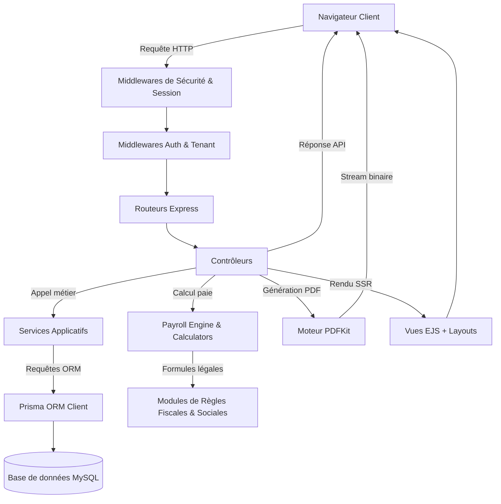
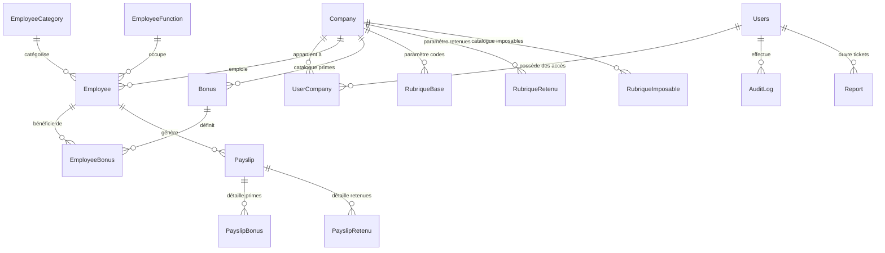
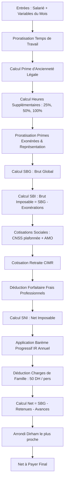
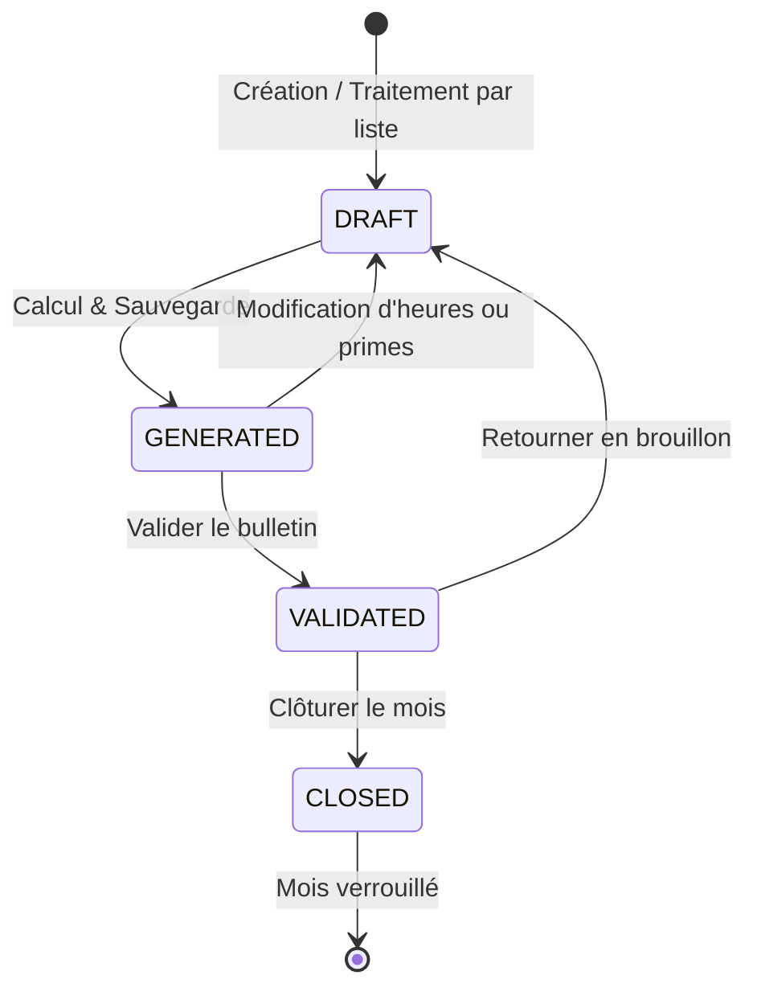
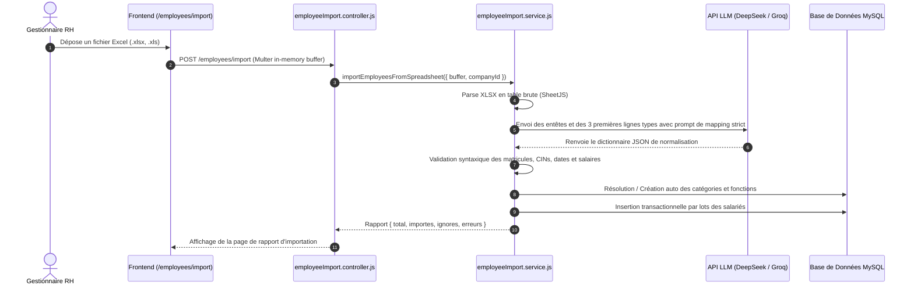
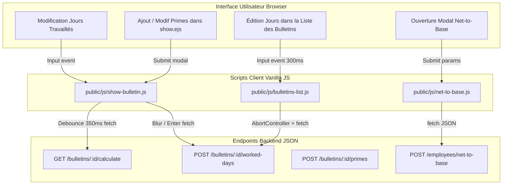

# Paie Software (Paie Train) — Architecture Complète & Guide Technique

Ce document fournit une vue d'ensemble exhaustive et approfondie du projet **Paie Software** : son architecture logicielle, le fonctionnement détaillé de son backend, son moteur de paie marocaine conforme aux dernières réformes, sa base de données relationnelle, et sa connexion intime avec le frontend hybride (EJS, JavaScript Vanilla réactif, HTMX, et PDFKit).

---

## Sommaire
1. [Vue d'Ensemble & Stack Technologique](#1-vue-densemble--stack-technologique)
2. [Architecture Globale & Flux de Données](#2-architecture-globale--flux-de-données)
3. [Sécurité, Authentification & Multi-Tenant](#3-sécurité-authentification--multi-tenant)
4. [Schéma de Données & Modélisation (Prisma / MySQL)](#4-schéma-de-données--modélisation-prisma--mysql)
5. [Le Moteur de Paie Marocain (Payroll Engine)](#5-le-moteur-de-paie-marocain-payroll-engine)
6. [Fonctionnalités Spéciales du Moteur](#6-fonctionnalités-spéciales-du-moteur)
   - [IR Cumulé Annuel (Lissage Fiscal)](#ir-cumulé-annuel-lissage-fiscal)
   - [Calcul Inverse : Net to Base](#calcul-inverse--net-to-base)
   - [Temps de Travail : Jours vs Heures](#temps-de-travail--jours-vs-heures)
7. [Cycle de Vie du Bulletin de Paie](#7-cycle-de-vie-du-bulletin-de-paie)
8. [Import Intelligent d'Employés par IA](#8-import-intelligent-demployés-par-ia)
9. [Génération & Éditions PDF (PDFKit)](#9-génération--éditions-pdf-pdfkit)
10. [Connexion Frontend - Backend & Interactions Réactives](#10-connexion-frontend---backend--interactions-réactives)
11. [Cartographie des Routes & Contrôleurs](#11-cartographie-des-routes--contrôleurs)
12. [Gestion des Paramètres & Rubriques de Paie](#12-gestion-des-paramètres--rubriques-de-paie)

---

## 1. Vue d'Ensemble & Stack Technologique

**Paie Software** est une application web professionnelle multi-entreprises dédiée à la gestion des ressources humaines et au traitement de la paie selon le code du travail et la législation fiscale du Royaume du Maroc.

### Stack Technique Principale

```
+--------------------------------------------------------------------------+
|                                FRONTEND                                  |
|   Server-Side Rendering (EJS) + Responsive CSS Modern (Variables CSS)    |
|   Vanilla JavaScript (ES6+ Modules, AbortController, Dialogs HTML5)      |
|   HTMX 2.0.4 (Requêtes partielles et redirections automatiques)           |
+--------------------------------------------------------------------------+
                                    ▲
                                    │ HTTP / HTTPS (JSON, HTML Forms, PDF)
                                    ▼
+--------------------------------------------------------------------------+
|                             BACKEND (Node.js)                            |
|   Runtime: Node.js (ES Modules natifs `type: module`, tsx)               |
|   Framework: Express 5.2.1                                               |
|   Sessions: express-session + express-mysql-session (persistance DB)     |
|   Sécurité: bcryptjs, Same-Origin Protection, Rate Limiter IP, Headers   |
|   Export PDF: PDFKit 0.20.1 (moteur vectoriel de streaming)              |
|   Parsing Excel: SheetJS (xlsx 0.18.5)                                   |
|   Intégration IA: API DeepSeek / Groq (normalisation de fichiers RH)     |
+--------------------------------------------------------------------------+
                                    ▲
                                    │ Prisma Client 6.19.0
                                    ▼
+--------------------------------------------------------------------------+
|                           BASE DE DONNÉES                                |
|   MySQL 8.0+ (InnoDB, UTF8mb4, transactions ACID, clés composites)       |
+--------------------------------------------------------------------------+
```

---

## 2. Architecture Globale & Flux de Données

Le système fonctionne selon un modèle MVC étendu (Modèle - Vue - Contrôleur - Services - Moteurs de calcul) :



### Découpage des Responsabilités
- **`index.js`** : Point d'entrée de l'application. Initialisation d'Express, du session store MySQL, configuration du moteur EJS, injection des middlewares de sécurité et montage hiérarchique des routeurs.
- **`src/routes/`** : Déclaration sémantique des routes, associées aux middlewares de filtrage et aux méthodes de contrôleurs.
- **`src/controllers/`** : Récupération des paramètres HTTP (body, query, params), validation syntaxique, orchestration des services, calculs et décision du mode de réponse (rendu HTML via `res.render`, flux JSON via `res.json`, ou téléchargement via `doc.pipe(res)`).
- **`src/services/`** : Logique métier persistance : opérations transactionnelles Prisma, mutations d'employés, synchronisations de bulletins brouillons, audit logs.
- **`src/payroll-engine/`** : Cœur mathématique et légal de l'application. Calculateur pur, déterministe et exempt de requêtes directes à la base de données.
- **`src/views/`** : Templates EJS structurés en layout principal (`layouts/main.ejs`), partials (`navbar`, `sidebar`, `footer`), et dossiers thématiques.
- **`public/`** : Fichiers statiques servis directement : CSS modulaire (`show-bulletin.css`, `custom.css`, `dialogs.css`) et scripts client (`show-bulletin.js`, `bulletins-list.js`, `net-to-base.js`, `dialogs.js`).

---

## 3. Sécurité, Authentification & Multi-Tenant

La sécurité de l'application repose sur une cascade de vérifications strictes :

```mermaid
flowchart LR
    Req[Requête entrante] --> Sec[Security Headers & Same-Origin]
    Sec --> Sess[Chargement Session MySQL]
    Sess --> IsAuth{isAuth ?}
    IsAuth -- Non --> RedirectLogin[/auth]
    IsAuth -- Oui --> IsAdminRoute{Route /admin ?}
    
    IsAdminRoute -- Oui --> AdminCheck{isAdmin ?}
    AdminCheck -- Non --> Forbidden403[403 ADMIN_ACCESS_REQUIRED]
    AdminCheck -- Oui --> AdminPanel[Accès Admin Panel]
    
    IsAdminRoute -- Non --> CompCheck{requireActiveCompany ?}
    CompCheck -- Non --> BlockedCheck{Compte bloqué ?}
    BlockedCheck -- Oui --> Blocked403[403 ACCOUNT_BLOCKED]
    BlockedCheck -- Non --> MemberCheck{Membre UserCompany ?}
    MemberCheck -- Non --> Forbidden[403 FORBIDDEN]
    MemberCheck -- Oui --> PeriodCheck{Période de Paie Valide ?}
    PeriodCheck -- Non --> PeriodConflict[409 Mois Non Clôturé]
    PeriodCheck -- Oui --> Action[Exécution Contrôleur]
```

### 1. Protection contre les attaques
- **Protection Same-Origin (`sameOriginProtection`)** : Pour toutes les requêtes de mutation (`POST`, `PUT`, `DELETE`), le serveur compare les headers `Origin` ou `Referer` avec l'en-tête `Host` du serveur. Rejette toute tentative de CSRF cross-domaine.
- **Rate Limiting IP (`loginRateLimit`)** : Limite les tentatives d'authentification à 10 requêtes par fenêtre glissante de 15 minutes par IP.
- **En-têtes HTTP sécurisés (`securityHeaders`)** :
  - `X-Content-Type-Options: nosniff`
  - `X-Frame-Options: DENY` (Anti-Clickjacking)
  - `Referrer-Policy: strict-origin-when-cross-origin`
  - `Permissions-Policy: camera=(), microphone=(), geolocation=()`
  - `Strict-Transport-Security` actif en production HTTPS.
- **Hachage des mots de passe** : Salage et hachage via `bcryptjs`. Aucun mot de passe en clair n'est stocké ni conservé en session.

### 2. Isolation Multi-Tenant (Entreprises)
- La table de jointure `userCompanies` relie chaque utilisateur à une ou plusieurs entreprises.
- Lors de la connexion, `req.session.user.activeCompanyId` est défini.
- Le middleware `requireActiveCompany` s'assure pour chaque requête que :
  1. L'utilisateur n'est pas bloqué (`isBlocked: false`).
  2. L'identifiant `activeCompanyId` appartient bien à la liste des sociétés autorisées pour cet utilisateur en base.
  3. Toutes les requêtes Prisma suivantes injectent `{ where: { companyId } }`.

### 3. Mode Support / Client Mode pour Administrateurs
Un administrateur peut inspecter ou dépanner le compte d'un client sans avoir à connaître son mot de passe :
1. L'administrateur active le mode support depuis `/admin/clients/:id/mode`.
2. Le serveur stocke le contexte dans `req.session.adminClientMode = { userId, companyId, userName, companyName }`.
3. `requireActiveCompany` autorise l'administrateur à opérer sur l'entreprise du client tout en traçant ses actions dans `audit_logs` avec l'action `ENTER_SUPPORT_MODE`.
4. Un bandeau jaune discret s'affiche sur le frontend avec un bouton « Quitter » qui restaure l'entreprise par défaut de l'administrateur.

---

## 4. Schéma de Données & Modélisation (Prisma / MySQL)

La base de données MySQL est orchestrée par Prisma (`prisma/schema.prisma`).



### Principaux Modèles et Champs Stratégiques

#### 1. `Company` (L'employeur / Tenant)
- `smig` : Salaire minimum interprofessionnel garanti.
- `workingTimeMode` : Mode de gestion du temps (`DAYS` ou `HOURS`).
- `standardMonthlyDays` : Base mensuelle par défaut (26 jours ouvrables légaux).
- `standardMonthlyHours` : Base mensuelle horaire par défaut (191 heures normales).
- `indemniteRepresentationRate` : Taux standard de l'indemnité de représentation (ex: `0.10` pour 10%).

#### 2. `Employee` (La fiche signalétique permanente RH)
- **Identité** : `matricule`, `nomComplet`, `cin`, `dateNaissance`, `sexe`.
- **Contrat & Emploi** : `dateEmbauche`, `dateAnciennete` (distincte de la date d'embauche pour reprise d'ancienneté), `dateSortie`, `natureEmploi` (`PERMANENT` / CDI, `OCCASIONNEL` / CDD, `STAGIAIRE`, `EXONERE`, `DOCTORANT`), `contratDateDebut`, `contratDateFin`.
- **Situation Familiale & Déductions** : `situationFam`, `nbPersonacharge`, `nbEnfantCharge`.
- **Rémunération & Retraite** : `baseSalary`, `cimrRate`, `cimrReduitBaseImposable` (définit si la cotisation CIMR réduit le brut avant déduction des frais professionnels).
- **Représentation** : `indemniteRepresentationRate`, `indemniteRepresentationName`.
- **Verrouillage de Paie** : `blocageSaisiePaie` (si vrai, l'employé est ignoré ou généré à zéro lors du calcul).

#### 3. `Payslip` (L'instantané mensuel historique du bulletin de paie)
Chaque ligne représente le résultat immuable d'un employé pour un couple `(month, year)` unique (`@@unique([employeeId, month, year])`).
- **Statut** : `DRAFT` (Brouillon), `GENERATED` (Généré), `VALIDATED` (Validé), `CLOSED` (Clôturé).
- **Bases & Temps** : `workedDays`, `workedHours`, `baseSalary` (base contractuelle effective proratisée).
- **Gains Bruts** : `primeAnciennete`, `bonusesIMP` (primes variables imposables), `bonusesNIMP` (indemnités non imposables), `heuresSupAmount`, `sbg` (Salaire Brut Global), `sbi` (Salaire Brut Imposable).
- **Charges Sociales** : `cnss`, `cnssRate`, `amo`, `amoRate`, `cimr`, `cimrRate`.
- **Fiscalité (IR)** : `fraisPro`, `fraisProRate`, `sni` (Salaire Net Imposable), `irTheorique`, `sommeADeduire`, `irBrut`, `chargesDeFamille`, `irNet`.
- **Lissage Annuel (Cumul)** : `sniCumule`, `moisEcoules`, `sniAnnuelEstime`, `irAnnuelEstime`, `irCumule`, `irPrecedent`.
- **Bas de Bulletin** : `avances`, `arrondi` (arrondi au dirham le plus proche), `netAPayer`.

#### 4. `PayslipBonus` et `PayslipRetenu`
Tables satellites archivant le libellé, le code rubrique, la base de calcul et le montant exact appliqué lors de la génération du bulletin, afin de garantir qu'une modification ultérieure du catalogue n'altère pas l'historique comptable.

---

## 5. Le Moteur de Paie Marocain (Payroll Engine)

Le fichier `src/payroll-engine/PayrollEngine.js` implémente un calculateur purement déterministe. Il reçoit un objet employé et des variables mensuelles (`overrides`), puis renvoie le bulletin complet sans effet de bord.

### L'Algorithme de Calcul Étape par Étape



### Détail des Formules de Calcul

#### 1. Proratisation du Salaire de Base
La base standard légale marocaine est de 26 jours ouvrables (ou 191 heures selon accord d'entreprise/secteur).
$$\text{Ratio} = \frac{\text{Jours Travaillés}}{\text{Jours Standard (26)}}$$
$$\text{Base Effective} = \text{Base Contractuelle} \times \text{Ratio}$$

#### 2. Prime d'Ancienneté Légale (Code du Travail Marocain)
Calculée sur la base effective + heures supplémentaires, à partir des mois d'ancienneté :
- Moins de 2 ans : $0\%$
- De 2 ans à moins de 5 ans ($24 \le m < 60$) : $5\%$
- De 5 ans à moins de 12 ans ($60 \le m < 144$) : $10\%$
- De 12 ans à moins de 20 ans ($144 \le m < 240$) : $15\%$
- De 20 ans à moins de 25 ans ($240 \le m < 300$) : $20\%$
- 25 ans et plus ($m \ge 300$) : $25\%$

#### 3. Heures Supplémentaires
Taux horaire légal : $\text{Taux Horaire} = \frac{\text{Base Effective}}{\text{standardMonthlyHours (191 h)}}$
- Majoration 25% : $\text{HS}_{25} \times \text{Taux Horaire} \times 1.25$
- Majoration 50% : $\text{HS}_{50} \times \text{Taux Horaire} \times 1.50$
- Majoration 100% : $\text{HS}_{100} \times \text{Taux Horaire} \times 2.00$

#### 4. Indemnité de Représentation (Exonérée)
Plafond légal usuel de 10% du salaire de base :
$$\text{Indemnité Représentation} = \text{Base Effective} \times \text{Taux Représentation (ex: 0.10)}$$
Toutes les indemnités non imposables récurrentes sont également proratisées au temps de travail effectif.

#### 5. SBG et SBI
$$\text{SBG} = \text{Base Effective} + \text{Ancienneté} + \text{Primes Imposables} + \text{Heures Sup} + \text{Indemnités Non Imposables}$$
$$\text{SBI} = \text{SBG} - \text{Indemnités Non Imposables (Exonérées)}$$

#### 6. Cotisations Sociales Salariales
- **CNSS Salariale** : Taux légal de **$4.48\%$**, plafonné à **6 000 DH** de SBI par mois.
  $$\text{CNSS} = \min(\text{SBI}, 6000) \times 0.0448 \quad (\text{Plafond Max : } 268.80\text{ DH})$$
- **AMO Salariale (Assurance Maladie Obligatoire)** : Taux de **$2.26\%$**, **non plafonné**.
  $$\text{AMO} = \text{SBI} \times 0.0226$$
- **CIMR (Retraite Complémentaire)** : Optionnelle, selon le taux contractuel du salarié (ex: 3% ou 6%).
  $$\text{CIMR} = \text{SBI} \times \text{cimrRate}$$

#### 7. Frais Professionnels (Abattement Fiscal pour Frais Inhérents à la Fonction)
Selon la législation fiscale marocaine réformée :
- Si $\text{SBI} \le 6\,500\text{ DH}$ : Taux de **$35\%$**, plafonné à **$2\,500\text{ DH}$/mois**.
- Si $\text{SBI} > 6\,500\text{ DH}$ : Taux de **$25\%$**, plafonné à **$2\,916.67\text{ DH}$/mois** ($35\,000\text{ DH}$/an).
> **Important** : Les frais professionnels constituent une déduction fiscale pure servant à déterminer l'assiette de l'IR. Ils ne sont **jamais** retranchés du salaire net payé à l'employé !

#### 8. Salaire Net Imposable (SNI)
$$\text{Base Avant Frais Pro} = \text{SBI} - \text{CNSS} - \text{AMO} - (\text{CIMR si fiscalement réductible})$$
$$\text{SNI} = \max(0, \text{Base Avant Frais Pro} - \text{Frais Professionnels})$$

#### 9. Impôt sur le Revenu (IR Brut et Net)
Le calcul utilise le barème progressif officiel annualisé :

| Tranche Annuelle de Revenu Net Imposable | Taux de l'IR | Somme à Déduire Annuelle |
| :--- | :---: | :---: |
| De 0 à 40 000 DH | **0%** | 0 DH |
| De 40 001 à 60 000 DH | **10%** | 4 000 DH |
| De 60 001 à 80 000 DH | **20%** | 10 000 DH |
| De 80 001 à 100 000 DH | **30%** | 18 000 DH |
| De 100 001 à 180 000 DH | **34%** | 22 000 DH |
| Au-delà de 180 000 DH | **37%** | 27 400 DH |

- Déduction pour charges de famille : **50 DH par personne à charge par mois** (enfants + conjoint à charge), dans la limite légale de **6 personnes** (soit **300 DH/mois** ou $3\,600\text{ DH}$/an).
$$\text{IR Net} = \max(0, \text{IR Brut} - \text{Charges de Famille})$$

#### 10. Net à Payer & Arrondi Monétaire
$$\text{Net Exact} = \text{SBG} - \text{CNSS} - \text{AMO} - \text{CIMR} - \text{IR Net} - \text{Avances}$$
$$\text{Arrondi} = \text{Math.round}(\text{Net Exact}) - \text{Net Exact}$$
$$\text{Net à Payer Final} = \text{Net Exact} + \text{Arrondi}$$
L'écart de centimes est explicitement exposé en gain ou en retenue d'arrondi sur le bulletin et le PDF.

---

## 6. Fonctionnalités Spéciales du Moteur

### IR Cumulé Annuel (Lissage Fiscal)
Implémenté dans `src/payroll-engine/calculators/cumulativeIr.calculator.js`.

Au Maroc, l'impôt sur le revenu est un impôt annuel liquidé mensuellement. Lorsque le salaire d'un employé varie au cours de l'année (primes exceptionnelles, augmentations, absences), un calcul isolé mois par mois pénaliserait le salarié ou fausserait la retenue fiscale globale.

**Algorithme de lissage appliqué :**
1. Lecture des bulletins validés ou clôturés antérieurs de l'année en cours : $\sum \text{SNI}_{\text{précédents}}$ et $\sum \text{IR Net}_{\text{précédent}}$.
2. Calcul du cumul du SNI incluant le mois en cours :
   $$\text{SNI Cumulé} = \sum \text{SNI}_{\text{antérieurs}} + \text{SNI}_{\text{courant}}$$
3. Détermination du nombre de mois écoulés $N$ (ex: 3 pour le mois de mars).
4. Annualisation mathématique du revenu :
   $$\text{SNI Annuel Estimé} = \left(\frac{\text{SNI Cumulé}}{N}\right) \times 12$$
5. Calcul de l'IR annuel théorique selon le barème officiel.
6. Détermination de la quote-part d'IR exigible à date :
   $$\text{IR Cumulé Dû} = \text{IR Annuel Estimé} \times \left(\frac{N}{12}\right)$$
7. Déduction de l'IR déjà retenu lors des mois passés :
   $$\text{IR Mensuel du Mois} = \text{IR Cumulé Dû} - \sum \text{IR}_{\text{déjà retenu}} - \text{Charges de Famille du Mois}$$

---

### Calcul Inverse : Net to Base
Implémenté dans `src/payroll-engine/netToBase.js`.

Lors de négociations d'embauche au Maroc, les candidats négocient couramment un **salaire net en poche**. L'employeur doit alors déterminer le salaire de base brut exact à inscrire au contrat pour aboutir rigoureusement à ce net, compte tenu de la situation familiale, de la CNSS plafonnée, des paliers de frais professionnels et des tranches d'IR.

**Difficulté mathématique :**
La fonction $f(\text{Base}) = \text{Net}$ n'est ni strictement continue ni strictement linéaire. Elle comporte des seuils d'abattement (notamment le changement de taux de frais professionnels à $6\,500\text{ DH}$ de SBI) et des plateaux de discrétisation induits par l'arrondi au dirham le plus proche.

**Stratégie de résolution :**
1. **Découpage par intervalles continus** : Le moteur identifie les points de rupture où le taux de frais professionnels bascule ($35\% \to 25\%$).
2. **Recherche dichotomique (Binary Search)** par intervalle sur les centimes entiers.
3. **Balayage local (Plateau Window Search)** : Une fois la zone cible approchée, un balayage de $\pm 128$ centimes est réalisé pour sélectionner la plus petite base brute produisant exactement le net souhaité.

---

### Temps de Travail : Jours vs Heures
Géré via `src/payroll-engine/utils/workingTime.js`.

L'entreprise peut configurer son mode d'exploitation :
- **Mode `DAYS`** (par défaut) : 26 jours standard. L'utilisateur saisit par exemple 20 jours. Le ratio appliqué est $20 / 26$. Les heures équivalentes sont automatiquement converties pour affichage :
  $$\text{Heures} = \text{round}\left(\frac{\text{Jours} \times 191}{26}\right)$$
- **Mode `HOURS`** : 191 heures standard. L'utilisateur saisit 140 heures. Le système calcule l'équivalent jours pour préserver la cohérence légale.

---

## 7. Cycle de Vie du Bulletin de Paie

Chaque bulletin de paie suit une machine à états finis garantissant l'intégrité comptable :



### 1. `DRAFT` / `GENERATED` (Brouillon éditable)
- Les jours travaillés, primes, indemnités et acomptes peuvent être modifiés à tout moment.
- Toute modification de la fiche employé (salaire de base, personnes à charge, prime d'ancienneté) déclenche une cascade de mise à jour automatique des bulletins non validés via `refreshDraftPayslips()`.

### 2. `VALIDATED` (Validé)
- Le bulletin est figé pour l'employé. Les champs de saisie deviennent `readOnly` ou `disabled`.
- Horodatage et traçabilité de l'utilisateur ayant validé le bulletin (`validatedAt`, `validatedById`).

### 3. `CLOSED` (Clôturé)
- Action collective mensuelle.
- Dès qu'un mois est clôturé, le middleware `enforceBulletinPeriod` autorise le passage au mois suivant ($M+1$).
- Il est strictement impossible d'effectuer des calculs ou d'émettre des bulletins sur le mois $M+1$ si le mois $M$ n'est pas intégralement clôturé.

---

## 8. Import Intelligent d'Employés par IA

Implémenté dans `src/services/employeeImport.service.js` et `src/controllers/employeeImport.controller.js`.

L'intégration de nouveaux clients RH se heurte souvent à la diversité des formats de tableurs Excel (colonnes inversées, libellés hétérogènes : « Dt Emb », « Hiring Date », « Matricule », « Sal. Base », « CIN », formats de dates variés).



### Robustesse & Fallback
- Le service intègre une détection dynamique du provider IA (priorité à `DEEPSEEK_API_KEY`, puis fallback sur `GROQ_API_KEY`).
- La réponse de l'IA est strictement assainie via `normalizeAIJsonContent` pour extraire uniquement le bloc JSON valide, même si le modèle a inséré des blocs markdown.

---

## 9. Génération & Éditions PDF (PDFKit)

Le module `src/pdf/bulletinPdf.js` utilise **PDFKit** pour créer des bulletins de paie vectoriels conformes aux standards d'impression marocains (format A4 portrait, typographie Helvetica, grille alignée au point typographique près).

### Éléments Présents sur le Bulletin PDF
1. **Entête Employeur** : Dénomination sociale, adresse, identifiants légaux (ICE, IF, RC, N° CNSS de l'entreprise).
2. **Cadre Salarié** : Matricule, Nom & Prénom, CIN, N° CNSS, Fonction, Catégorie, Département, Date de naissance, Date d'embauche, Ancienneté, Situation familiale, Nombre d'enfants et de personnes à charge.
3. **Tableau des Éléments de Paie** (7 colonnes) :
   - `RUB` (Code rubrique paramétré de la société)
   - `LIBELLÉS` (Base, Ancienneté, Heures Sup, Primes, Indemnités, CNSS, AMO, CIMR, IR, Avances, Arrondi)
   - `COTIS. PATR.` (Part patronale CNSS et AMO calculée pour transparence du coût global)
   - `NBR / BASE` (Jours travaillés, base brute soumise ou plafond 6000 DH)
   - `TAUX` (Taux salarial appliqué : ex 4.48%, 2.26%, barème IR)
   - `GAINS` (Montants bruts versés)
   - `RETENUES` (Déductions salariales opérées)
4. **Bloc des Cumuls Annuels** : Jours travaillés dans l'année, Heures, Total Brut imposable cumulé, CNSS cumulée, Retraite cumulée, SNI cumulé, IR Net cumulé.
5. **Pied de Bulletin** : Mode de règlement (Virement, Chèque), Espace Signature, et cartouche mis en valeur du **Net à Payer**.

### Édition en Masse par Plage de Matricules
Accessible via `/editions/bulletins` : permet d'exporter en un seul fichier PDF tous les bulletins du mois entre deux matricules (ex: du matricule `1` au matricule `50`), en utilisant le chaînage dynamique `doc.addPage()`.

---

## 10. Connexion Frontend - Backend & Interactions Réactives

L'application allie la simplicité du rendu côté serveur (SSR EJS) à la réactivité d'une Single Page Application sans framework lourd (React/Vue), grâce à des modules JavaScript légers et bien ciblés.

### Matrice des Interactions Réactives



### 1. Recalcul en Direct sur la Fiche Bulletin (`show-bulletin.js`)
- **Débouncing de 350 ms** : Dès que l'utilisateur tape un chiffre dans un champ variable (`live-input`, heures sup, primes), un minuteur suspend les requêtes superflues.
- **Requête Asynchrone** : Appel vers `GET /bulletins/:id/calculate?month=X&year=Y&...`.
- **Gestion de Version de Requête (`calculationVersion`)** : Si l'utilisateur tape vite, les réponses asynchrones obsolètes arrivant dans le désordre sont automatiquement écartées.
- **Mise à jour sélective du DOM** : Seuls les attributs `[data-result="sbg"]`, `[data-result="sbi"]`, `[data-result="netAPayer"]`, et les lignes de cotisations sociales sont modifiés dans le DOM sans recharger la page.

### 2. Édition Inline dans la Table des Bulletins (`bulletins-list.js`)
- Le gestionnaire de paie peut ajuster les jours travaillés directement dans le tableau récapitulatif du mois sans ouvrir chaque bulletin individuellement.
- La frappe déclenche un calcul d'aperçu après 300 ms.
- La touche **Entrée** ou la perte de focus (**Tab / Blur**) déclenche immédiatement un `POST /bulletins/:id/worked-days` qui recalcule l'IR cumulé et sauvegarde le bulletin en base de données.
- En cas de navigation accidentelle avec des modifications non sauvegardées, l'événement `beforeunload` alerte l'utilisateur.

### 3. Fenêtres Modales Modernes (`HTMLDialogElement`)
- Utilisation de la balise HTML5 standard `<dialog>`.
- Gérée par `public/js/dialogs.js` qui fournit une API uniforme :
  - `window.AppDialog.confirm(message, options)`
  - `window.AppDialog.alert(message)`
- Aucun rechargement de page nécessaire pour ajouter ou supprimer des primes variables ou des indemnités non imposables.

---

## 11. Cartographie des Routes & Contrôleurs

| Méthode | Route HTTP | Contrôleur / Handler | Rôle & Type de Réponse |
| :--- | :--- | :--- | :--- |
| **GET** | `/auth` | `auth.controller.loginPage` | Page HTML de connexion |
| **POST** | `/auth/login` | `auth.controller.login` | Authentification, session MySQL, redirection |
| **GET** | `/auth/select-company` | `auth.controller.selectCompanyPage` | Sélection du tenant actif |
| **POST** | `/auth/logout` | `auth.controller.logout` | Destruction de session |
| **GET** | `/dashboard` | `dashboard.controller.renderDashboard` | Métriques, masse salariale, effectifs |
| **GET** | `/employees` | `employee.controller.listEmployees` | Liste paginée / filtrée des employés |
| **GET** | `/employees/create` | `employee.controller.renderCreateForm` | Formulaire de création salarié |
| **POST** | `/employees/create` | `employee.controller.handleCreateEmployee` | Enregistrement de l'employé |
| **GET** | `/employees/:id` | `employee.controller.employeeshow` | Fiche détaillée et simulation de paie |
| **POST** | `/employees/:id/edit` | `employee.controller.handleUpdateEmployee` | Mise à jour profil salarié |
| **POST** | `/employees/net-to-base` | `netToBase.controller.calculateNetToBase` | API JSON de calcul inverse |
| **GET** | `/employees/import` | `employeeImport.controller.importPage` | Interface d'import Excel |
| **POST** | `/employees/import` | `employeeImport.controller.importEmployees` | Traitement IA & injection en base |
| **GET** | `/bulletins` | `bulletins.controller.listBulletins` | Tableau des paies du mois sélectionné |
| **POST** | `/bulletins/generate-bulk` | `bulletins.controller.generateBulkBulletins` | Traitement groupé de tout l'effectif |
| **POST** | `/bulletins/validate-bulk` | `bulletins.controller.validateBulkBulletins` | Validation groupée du mois |
| **POST** | `/bulletins/close-bulk` | `bulletins.controller.closeBulkBulletins` | Clôture définitive du mois |
| **GET** | `/bulletins/:id` | `bulletins.controller.showBulletin` | Fiche détaillée du bulletin de paie |
| **GET** | `/bulletins/:id/calculate` | `bulletins.controller.calculateLive` | API JSON de simulation en direct |
| **POST** | `/bulletins/:id/worked-days`| `bulletins.controller.updateBulletinWorkedDays` | Sauvegarde rapide du temps de travail |
| **POST** | `/bulletins/:id/primes` | `bulletins.controller.addMonthlyPrime` | Ajout d'une prime variable au bulletin |
| **GET** | `/bulletins/:id/pdf` | `bulletins.controller.downloadPdfBulletin` | Téléchargement du PDF individuel |
| **GET** | `/editions/bulletins` | `editions.renderBulletinExportPage` | Interface d'export par plage |
| **POST** | `/editions/bulletins/pdf` | `editions.post("/bulletins/pdf")` | Téléchargement PDF groupé par matricules |
| **GET** | `/parametrage` | `company.controller.settingsPage` | Paramètres société (SMIG, Heures, ICE) |
| **GET** | `/rubriques` | `rubrique.controller.index` | Gestion des codes rubriques par société |
| **GET** | `/admin` | `admin.controller.adminDashboard` | Tableau de bord super-administrateur |
| **POST** | `/admin/clients/:id/mode` | `admin.controller.enterClientMode` | Activation du mode support client |

---

## 12. Gestion des Paramètres & Rubriques de Paie

Une exigence fondamentale de la comptabilité de paie marocaine est que **chaque entreprise attribue ses propres codes de rubriques** pour l'exportation vers son logiciel comptable (ex: Sage, Cegid, SAP).

Dans Paie Software, aucun code de rubrique n'est codé en dur :
1. **Rubriques de Base (`RubriqueBase`)** :
   - Salaire de base (`base_salary`) : ex `1001`
   - Prime d'ancienneté (`seniority_bonus`) : ex `1002`
   - Salaire brut imposable (`taxable_gross_salary`) : ex `3001`
   - Salaire net imposable (`taxable_net_salary`) : ex `3501`
   - Salaire net à payer (`net_salary`) : ex `4001`
2. **Rubriques de Retenues (`RubriqueRetenu`)** :
   - Retenue CNSS (`cnss`) : ex `2001`
   - Retenue AMO (`amo`) : ex `2002`
   - Retenue CIMR (`cimr`) : ex `2003`
   - Impôt sur le revenu IR (`income_tax`) : ex `2004`
   - Avance sur salaire (`salary_advance`) : ex `2005`
   - Frais professionnels (`professional_expenses`) : ex `2006`
   - Arrondi (`rounding`) : ex `2007`
3. **Catalogue des Éléments Imposables (`RubriqueImposable`)** :
   - Heures supplémentaires 25%, 50%, 100%
   - Primes exceptionnelles, gratifications de fin d'année, congés payés.
4. **Catalogue des Indemnités Exonérées (`Bonus` avec `taxable: false`)** :
   - Panier, transport, représentation, salissure, outillage, etc.

Grâce à `src/services/rubrique.service.js`, la fonction `getRubriqueMaps(companyId)` compile ce dictionnaire pour chaque société active. Le frontend web ainsi que le générateur PDFKit partagent exactement la même cartographie de codes.

---

## Conclusion & Synthèse

Le projet **Paie Software** représente une implémentation complète, robuste et fidèle de la paie marocaine :
- **Séparation étanche** : Architecture sécurisée, isolation des données par tenant, protection CSRF et contrôle d'accès multi-rôles.
- **Précision réglementaire** : Implémentation scrupuleuse des textes de lois marocains (barème IR progressif, calcul de l'ancienneté, plafonnement CNSS à 6 000 DH, AMO déplafonnée, paliers de frais professionnels 35%/25% et lissage fiscal annuel).
- **Expérience utilisateur fluide** : Rendu rapide par serveur (SSR) renforcé par des points d'API réactifs permettant un recalcul instantané sans rupture de contexte.
- **Outils avancés** : Résolution mathématique inverse (Net vers Base), import assisté par Intelligence Artificielle et génération vectorielle haute définition des bulletins officiels.
