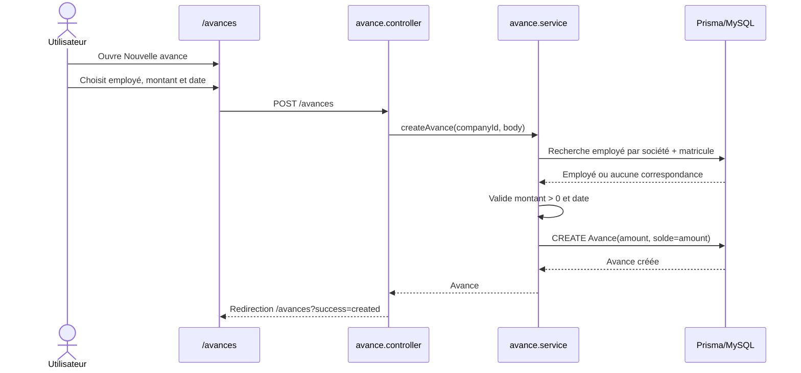
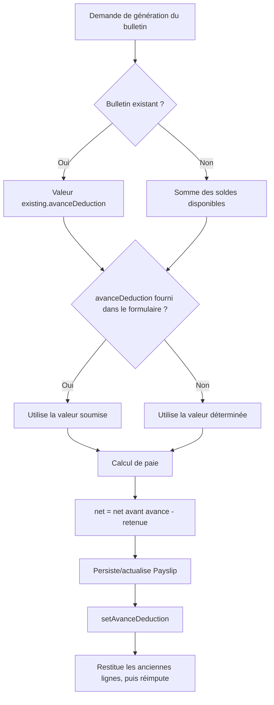
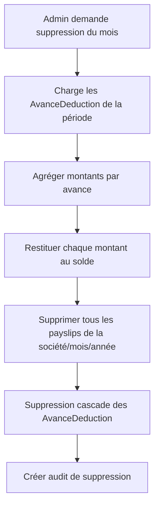

# Avances sur salaire — logique, flux et fonctionnement

Ce document décrit l’implémentation **actuelle** des avances sur salaire dans l’application.

## 1. Objectif fonctionnel

Une avance représente un versement préalable accordé à un employé. Elle est conservée avec son montant initial et son solde restant.

```text
Montant accordé = solde initial
Solde courant    = montant accordé - retenues déjà appliquées aux bulletins
Net à payer     = net de paie avant avance - retenue d’avance
```

Les avances sont distinctes des retenues manuelles configurées avec les rubriques de retenue.

## 2. Modèle de données

### 2.1 `Avance`

Définie dans `prisma/schema.prisma` dans le modèle `Avance` :

| Champ | Type | Rôle |
|---|---:|---|
| `id` | `Int` | Identifiant de l’avance |
| `employeeId` | `Int` | Employé bénéficiaire |
| `amount` | `Decimal(12,2)` | Montant initial accordé |
| `solde` | `Decimal(12,2)` | Solde disponible pour les futures retenues |
| `date` | `Date` | Date de l’avance |
| `createdAt` | `DateTime` | Date de création |
| `updatedAt` | `DateTime` | Dernière modification |

L’avance appartient à un employé par la relation `employee`. Sa suppression cascade vers ses lignes de déduction.

### 2.2 `AvanceDeduction`

Chaque application d’une retenue sur un bulletin crée une association entre une avance et un payslip :

| Champ | Type | Rôle |
|---|---:|---|
| `id` | `Int` | Identifiant de la ligne |
| `avanceId` | `Int` | Avance imputée |
| `payslipId` | `Int` | Bulletin concerné |
| `amount` | `Decimal(12,2)` | Montant imputé sur cette avance et ce bulletin |

Contraintes :

- Une seule ligne par couple `(avanceId, payslipId)` grâce à `@@unique([avanceId, payslipId])`.
- La suppression d’une ligne de bulletin cascade vers les lignes d’imputation.
- La suppression d’une avance cascade vers ses imputations.

### 2.3 Champs du `Payslip`

Dans le modèle `Payslip` :

- `avanceDeduction : Decimal(12,2)` : montant total retenu sur le bulletin.
- `avanceDeductionConfigured : Boolean` : indique que la retenue a été explicitement configurée.
- `avanceDeductions : AvanceDeduction[]` : détails des avances utilisées par le bulletin.
- `netAPayer : Decimal(12,2)` : net final déjà réduit de la retenue d’avance.

Le champ `avanceDeduction` est donc un total historique/affiché du bulletin. Les lignes `AvanceDeduction` permettent de connaître quelle avance a financé chaque partie et de restituer les soldes.

## 3. Services concernés

La logique principale est centralisée dans `src/services/avance.service.js`.

Services et responsabilités :

- `listAvances()` : liste les avances actives de la société courante, triées par date décroissante puis ID décroissant.
- `listCompanyEmployees()` : liste les employés non bloqués de la société pour la création d’une avance.
- `createAvance()` : crée une avance pour un employé de la société.
- `listEmployeeAvances()` : retourne les soldes positifs d’un employé, triés du plus ancien au plus récent.
- `setAvanceDeduction()` : remplace intégralement l’imputation du bulletin demandé.
- `removeAvanceDeduction()` : supprime une imputation précise liée à un bulletin.
- `deductAvance()` : déduit un montant d’une avance précise. Cette fonction existe dans le service mais n’est pas montée sur une route dédiée dans l’état actuel.

### Dépendances importantes

- `src/controllers/avance.controller.js` expose la page et la création.
- `src/routes/avances.js` monte les routes `/avances`.
- `src/controllers/bulletins.controller.js` calcule et persiste la paie avec la retenue d’avance.
- `src/payroll-engine/PayrollEngine.js` soustrait la retenue du net calculé.
- `src/pdf/bulletinPdf.js` affiche la retenue sur le PDF.
- `src/views/bulletins/show.ejs` affiche la ligne de retenue sur le bulletin.

## 4. Création d’une avance

### Page `/avances`

La vue `src/views/avances/index.ejs` propose :

1. Une liste de toutes les avances visibles pour la société active.
2. Une recherche par matricule ou nom.
3. Un dialogue « Nouvelle avance ».
4. Un sélecteur limité aux employés dont `blocageSaisiePaie` vaut `false`.
5. Les champs : matricule, montant, date.

### Flux



### Règles de validation

Lors de la création :

- Le montant doit être un nombre fini strictement supérieur à zéro.
- Le montant est arrondi à deux décimales.
- La date doit être une date valide.
- Le matricule ne peut pas être vide.
- L’employé doit appartenir à la société active.
- Le solde initial est égal au montant initial.

Messages possibles :

- `EMPLOYEE_MATRICULE_REQUIRED` → « Sélectionnez un employé. »
- `EMPLOYEE_NOT_FOUND` → « Aucun employé ne correspond à ce matricule. »
- `INVALID_ADVANCE_AMOUNT` → « Saisissez un montant valide. »
- Une date invalide → « Saisissez une date valide. »

## 5. Sélection des avances disponibles

`listEmployeeAvances(employeeId)` retourne uniquement les avances dont `solde > 0`.

L’ordre de consommation dans les nouvelles imputations est :

```text
1. Plus ancienne date
2. Plus petit ID en cas d’égalité de date
```

Ce FIFO utilise le solde restant, pas le montant initial.

## 6. Imputation automatique à un bulletin

### Création ou régénération d’un bulletin individuel

Dans `generateBulletin()` de `src/controllers/bulletins.controller.js` :

1. Recherche du bulletin existant pour l’employé, le mois et l’année.
2. Vérifie que le bulletin n’est ni validé ni clôturé.
3. Détermine la retenue demandée :
   - Si `req.body.avanceDeduction` existe : utilise sa valeur, positive ou nulle.
   - Sinon, pour un bulletin existant : conserve `existing.avanceDeduction`.
   - Sinon, additionne tous les soldes d’avance positifs de l’employé.
4. Lance le calcul de paie avec `avanceDeduction` dans les overrides.
5. Soustrait la retenue du net à payer final.
6. Crée ou met à jour le `Payslip`.
7. Appelle `setAvanceDeduction()` pour remplacer les lignes d’imputation et ajuster les soldes.



### Comportement du premier bulletin

Pour un nouveau bulletin, si aucun montant explicite n’est soumis, l’application propose initialement la somme de tous les soldes disponibles de l’employé.

Dans le calcul de prévisualisation sans bulletin enregistré, le montant affiché est également la somme des soldes disponibles.

La génération en masse ne suit pas automatiquement ce chemin : `generateBulkBulletins()` crée les bulletins sans appeler `setAvanceDeduction()`. Il appartient donc à la génération individuelle d’initialiser ou de modifier les imputations détaillées.

## 7. `setAvanceDeduction()` — remplacement transactionnel

Cette fonction est utilisée lors de la génération individuelle et des endpoints d’ajout/modification de retenue.

### Étapes

1. Valide que le montant demandé est un nombre fini supérieur ou égal à zéro.
2. Vérifie que le bulletin existe pour l’employé/mois/année et la société active.
3. Refuse les bulletins validés ou clôturés.
4. Charge toutes les anciennes lignes `AvanceDeduction` du bulletin.
5. Additionne leur montant précédent.
6. Pour chaque ancienne ligne, incrémente le solde de l’avance correspondante.
7. Supprime toutes les anciennes lignes du bulletin.
8. Charge les avances positives de l’employé, du plus ancien au plus récent.
9. Vérifie que la somme des soldes disponibles suffit au nouveau montant.
10. Décrémente chaque avance selon la nouvelle imputation, jusqu’à épuisement du montant demandé.
11. Crée une ligne `AvanceDeduction` par avance utilisée.
12. Recalcule le `netAPayer` du payslip avec la retenue demandée.
13. Fixe `avanceDeductionConfigured = true`.

Toutes ces opérations sont effectuées dans une transaction Prisma. Une erreur annule entièrement l’opération.

```mermaid
sequenceDiagram
    participant Caller as Contrôleur bulletin
    participant Tx as Transaction Prisma
    participant Payslip as Payslip
    participant Link as AvanceDeduction
    participant Advance as Avance

    Caller->>Tx: setAvanceDeduction(montant demandé)
    Tx->>Payslip: Charge le bulletin
    Tx->>Payslip: Vérifie société et verrouillage
    Tx->>Link: Charge les anciennes imputations
    Tx->>Advance: Restitue tous les anciens montants
    Tx->>Link: Supprime les anciennes imputations
    Tx->>Advance: Charge les soldes disponibles
    Tx->>Tx: Vérifie montant demandé <= solde disponible
    loop Avances anciennes vers nouvelles
        Tx->>Advance: Décrémente la part imputée
        Tx->>Link: Crée l’imputation
    end
    Tx->>Payslip: Sauvegarde total, configured=true et net
```

### Exemple

L’employé possède :

- Avance A : 800 DH
- Avance B : 500 DH

Une retenue de 1 100 DH produit :

```text
800 DH sur Avance A
300 DH sur Avance B
A.solde = 0
B.solde = 200
Payslip.avanceDeduction = 1100
```

### Restauration avant réimputation

`setAvanceDeduction()` restaure d’abord les anciennes lignes avant de vérifier le nouveau montant. Cela évite qu’une baisse ou une augmentation du montant demandé bloque à cause du solde déjà engagé sur le même bulletin.

Le comportement historique est donc :

```text
solde immédiatement disponible après restitution + montant disponible =
montant maximal restant utilisable pour le nouveau bulletin
```

## 8. Ajout et suppression depuis le bulletin

### Route d’ajout/modification

`POST /bulletins/:id/avances` appelle `addAvanceDeduction()` puis `setAvanceDeduction()` avec le montant transmis dans `req.body.amount`.

Erreurs traduites :

- `PAYSLIP_REQUIRED` : générez le bulletin avant d’ajouter une avance.
- `BULLETIN_LOCKED` : ce bulletin est verrouillé.
- `ADVANCE_BALANCE_TOO_LOW` : le montant dépasse le solde disponible.
- `INVALID_ADVANCE_AMOUNT` : saisissez un montant d’avance valide.

### Route de suppression d’une ligne précise

`POST /bulletins/:id/avances/delete` appelle `removeAvanceDeduction()` avec `deductionId`.

Le service :

1. Vérifie que le bulletin existe dans la société active.
2. Vérifie que le bulletin n’est ni validé ni clôturé.
3. Recherche la ligne dans ce payslip uniquement.
4. Restitue son montant au solde de son avance.
5. Supprime la ligne `AvanceDeduction`.
6. Diminue le total du payslip.
7. Remonte le `netAPayer` du même montant.

Aucune déduction portant sur un autre bulletin ou une autre société ne peut être supprimée par cette route, car la ligne est recherchée avec le payslip courant.

### Fonction `deductAvance()`

Cette variante permet d’ajouter une imputation sur une avance précise au lieu de répartir automatiquement un total. Elle :

1. Vérifie le bulletin et son verrouillage.
2. Vérifie que l’avance possède un solde suffisant.
3. Décrémente l’avance.
4. Crée ou échoue sur une ligne unique pour l’avance et le bulletin.
5. Augmente `avanceDeduction` et diminue `netAPayer`.

Elle utilise une contrainte unique sur `(avanceId, payslipId)`, donc elle ne peut pas accumuler deux lignes distinctes pour la même avance sur le même bulletin via cette fonction.

## 9. Calcul du net

### Moteur de paie

Dans `src/payroll-engine/PayrollEngine.js`, l’ordre simplifié est :

```text
Net brut avant avance = SBG - CNSS - AMO - CIMR - IR net + arrondi
Net final            = max(0, net brut avant avance - avanceDeduction)
```

Le moteur retourne aussi `avanceDeduction` dans son résultat.

### Contraintes de calcul

- Montant négatif soumis : ramené à zéro avec `Math.max(0, ...)` dans plusieurs chemins.
- Le net final ne peut pas devenir négatif : il est plafonné à zéro.
- Les montants sont arrondis à deux décimales avant les opérations de solde.
- Le bulletin conserve le résultat net historique ; les recalculs de bulletin soustraient de nouveau la retenue.

### Affichages

La retenue est affichée dans :

- La vue bulletin HTML : « Avance sur salaire ».
- Le PDF : rubrique configurable d’« Avance sur salaire » ou code `AV` par défaut.
- La vue de résultats AJAX : `avanceDeduction` et déductions totales.

## 10. Recalcul et mise à jour de bulletin

Lorsque un bulletin ouvert est recalculé après modification d’un élément de paie ou d’un employé :

1. Le montant `avanceDeduction` est chargé depuis le payslip existant.
2. Le moteur produit un nouveau net avant avance.
3. L’application soustrait de nouveau le montant d’avance conservé.
4. Le payslip est mis à jour avec ce montant.
5. Les soldes ne sont pas décrémentés une deuxième fois, sauf si `setAvanceDeduction()` est appelé séparément avec le montant total.

`buildPayslipData()` contient aussi une protection : si `calc.avanceDeduction` vaut zéro, elle cherche l’ancienne retenue dans le payslip et l’applique au nouveau calcul.

Ainsi, une modification d’une prime, d’un jour travaillé ou d’une indemnité ne doit pas faire disparaître par inadvertance la retenue d’avance du bulletin.

## 11. Verrouillage

Les statuts verrouillés sont `VALIDATED` et `CLOSED`.

Une imputation ou suppression d’avance est refusée si le bulletin possède l’un de ces statuts.

Autres effets de verrouillage :

- `generateBulletin()` bloque la régénération si le bulletin existe déjà comme validé.
- `setAvanceDeduction()` bloque tout remplacement d’imputation sur un bulletin validé ou clôturé.
- `removeAvanceDeduction()` bloque toute restauration depuis un bulletin validé ou clôturé.

Les bulletins `DRAFT` ou `GENERATED` peuvent être recalculés ou réimputés tant qu’ils ne sont pas verrouillés.

## 12. Isolation par société

Toutes les opérations de création et d’imputation utilisent un `companyId` de la société active.

- `listAvances()` filtre les employés par société.
- `createAvance()` recherche l’employé uniquement dans cette société.
- Les employés disponibles proviennent uniquement de cette société.
- `setAvanceDeduction()` et `removeAvanceDeduction()` vérifient que le payslip appartient à un employé de la société active.
- Les routes ne doivent pas pouvoir déduire une avance en fournissant directement un ID d’employe d’une autre société.

Lors des tests ou diagnostics, l’identité de la société doit être vérifiée via le contexte actif, pas via un identifiant soumis librement par le client.

## 13. Suppression administrative de bulletins

La route administrative `POST /admin/companies/:id/bulletins/delete` supprime tous les bulletins de la société pour un mois/année donné.

Avant suppression, le service administratif :

1. Charge toutes les lignes `AvanceDeduction` des bulletins concernés.
2. Agrège les montants par `avanceId`.
3. Incrémente le solde de chaque avance concernée dans le périmètre de la société.
4. Supprime les payslips du mois concerné.
5. Les lignes `AvanceDeduction` sont supprimées par cascade avec les payslips.
6. Enregistre un audit `DELETE_COMPANY_MONTH_BULLETINS`.



Cette restauration est transactionnelle. Si une restauration échoue, les suppressions ne sont pas appliquées.

### Limite de la suppression

La documentation/admin indique que les bulletins de périodes suivantes ne sont pas recalculés automatiquement. Le cumul d’IR ou les données historiques ne doivent pas être supposés automatiquement reconstruits par cette opération.

## 14. Cycles de données

### Cycle normal

```text
Création d’une avance
    → solde initial = montant initial
    → génération/modification du bulletin
    → restitution éventuelle des anciennes lignes
    → imputation FIFO sur les avances disponibles
    → diminution des soldes
    → augmentation avanceDeduction du bulletin
    → diminution netAPayer
    → affichage/PDF
```

### Modification du montant retenu

```text
Anciennes lignes du bulletin
    → restitution de toutes les parts aux avances
    → suppression des anciennes lignes
    → vérification du nouveau montant
    → nouvelle imputation FIFO
    → mise à jour du total et du net
```

### Suppression administrative de la période

```text
Lignes du bulletin supprimé
    → restitution agrégée aux avances
    → suppression des payslips
    → suppression cascade des lignes d’imputation
```

## 15. Précision et arrondis

- Les avances sont stockées en `Decimal(12,2)`.
- Les montants utilisateur sont convertis en nombre puis arrondis à deux décimales à la création.
- Les `AvanceDeduction` utilisent aussi `Decimal(12,2)`.
- Les soldes doivent être décrémentés et incrémentés avec une précision de deux décimales.
- Lorsqu’une somme disponible est vérifiée, une tolérance de `0.005` est utilisée dans `setAvanceDeduction()` pour absorber de petites différences décimales.
- Le net final est arrondi à deux décimales dans les opérations de retenue, mais la paie présente aussi un arrondi final vers le dirham entier avec une ligne d’arrondi séparée.

## 16. Erreurs courantes

| Erreur | Cause |
|---|---|
| `NO_ACTIVE_COMPANY` | Aucun identifiant de société valide dans le contexte |
| `INVALID_ADVANCE_AMOUNT` | Montant nul, négatif ou non numérique |
| `INVALID_ADVANCE_DATE` | Date absente ou invalide |
| `EMPLOYEE_MATRICULE_REQUIRED` | Matricule absent |
| `EMPLOYEE_NOT_FOUND` | Employé absent dans la société active |
| `PAYSLIP_REQUIRED` | Aucun bulletin pour l’employé/période |
| `BULLETIN_LOCKED` | Bulletin validé ou clôturé |
| `ADVANCE_BALANCE_TOO_LOW` | Le montant demandé dépasse le solde disponible |
| `DEDUCTION_NOT_FOUND` | Ligne d’imputation absente du payslip courant |
| `INVALID_ADVANCE_DEDUCTION` | Donnée administrative invalide lors de l’agrégation/restauration |
| `ADVANCE_RESTORE_FAILED` | Solde administratif impossible à restituer |

## 17. Risques et points de vigilance actuels

- Les avances ne doivent jamais être déduites d’un bulletin validé ou clôturé.
- La génération individuelle doit rester la source de synchronisation des lignes détaillées ; sinon le `Payslip` peut avoir un total sans lignes d’imputation cohérentes.
- La génération en masse actuelle crée les bulletins mais ne déduit pas automatiquement les soldes via `setAvanceDeduction()`.
- Sur un nouveau bulletin individuel, la somme automatique de tous les soldes est un comportement actuel du contrôleur/aperçu, pas une règle légalement imposée : elle doit rester visible à l’utilisateur dans l’interface finale.
- `deductAvance()` existe dans le service mais aucune route dédiée pour une avance précise n’est actuellement visible dans le routeur des bulletins.
- Un billet supprimé par suppression administrative restaure les soldes, mais les périodes suivantes ne sont pas explicitement recalculées.
- L’application distingue les avances des retenues manuelles, mais les deux lignes diminuent toutes deux le net affiché.

## 18. Fichiers de référence

- `src/services/avance.service.js`
- `src/controllers/avance.controller.js`
- `src/routes/avances.js`
- `src/controllers/bulletins.controller.js`
- `src/controllers/admin.controller.js`
- `src/routes/bulletins.js`
- `src/views/avances/index.ejs`
- `src/views/bulletins/show.ejs`
- `src/payroll-engine/PayrollEngine.js`
- `src/pdf/bulletinPdf.js`
- `prisma/schema.prisma`
- `test_admin_delete_month_bulletins.js`
- `docs/business/BUSINESS_CONSTRAINTS.md`
- `docs/database/DATABASE_SCHEMA.md`
- `docs/business/PAYROLL_WORKFLOW.md`
